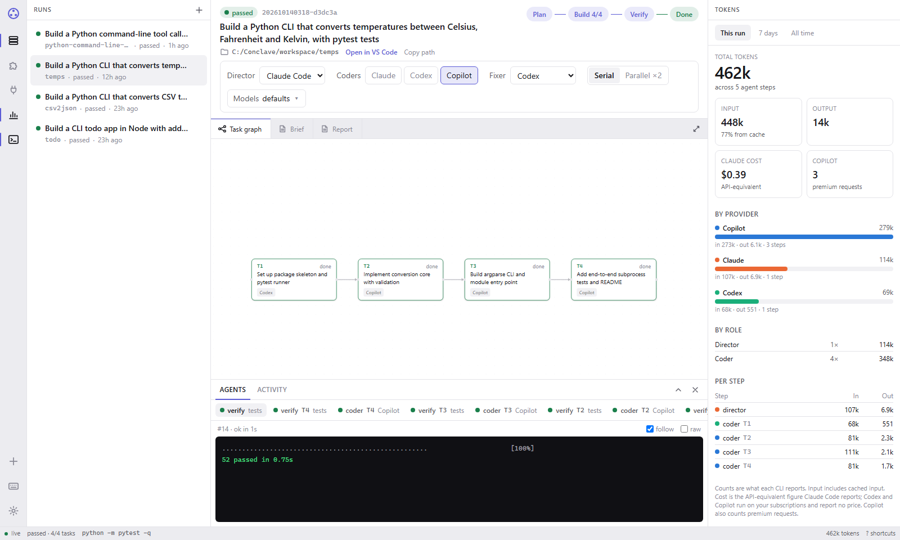

# Conclave

**One prompt in, a tested project out.** Conclave runs Claude Code, Codex CLI and GitHub Copilot CLI as one team on your own computer, using your own subscriptions. You describe what you want in one sentence. A Director agent plans it, coder agents build each piece tests-first, and the test suite decides when it's done. A live dashboard shows every step, and you can change who does what while it runs.



- **Plans before it builds.** A brief with goals and assumptions, and a task graph where each task has acceptance criteria and the tests that prove it.
- **Tests decide.** Coders write tests first, and a failing task goes to a fixer agent, up to three tries.
- **Your team, your choice.** Pick the Director, the coders (one, or several taking turns) and the fixer, and change them mid-run.
- **Pick the model.** Choose each agent's model and reasoning effort from its live model list, and change them mid-run.
- **Connectors and plugins.** Give agents MCP servers (docs lookup, GitHub and more, with one-click presets) and manage each CLI's plugins from the dashboard.
- **Serial or parallel.** Independent tasks can be built side by side, each in its own git branch, and merged when green.
- **See everything.** A live task graph, each agent's output, diffs, the brief and report in a full-screen reader, and a token dashboard showing what each agent used.
- **Safe by default.** Agents work inside a Docker container that only sees your projects folder. See [SECURITY.md](SECURITY.md).

## What you need

- **Docker Desktop** (Windows, macOS) or Docker Engine (Linux). On Windows, use the WSL 2 engine.
- **At least one of these subscriptions.** Conclave uses your own logins and never shares them:
  - **Claude** (Pro or Max) for Claude Code, the default Director
  - **ChatGPT** (Plus, Pro or Team) for Codex, the default coder and fixer
  - **GitHub Copilot** for Copilot CLI
- About 2 GB of free disk space.

With only one subscription, set every role to that agent when you start a run.

## Install

**Windows** (PowerShell):

```powershell
irm https://raw.githubusercontent.com/MVSanjayNiranjan/conclave/main/install.ps1 | iex
```

**macOS / Linux**:

```bash
curl -fsSL https://raw.githubusercontent.com/MVSanjayNiranjan/conclave/main/install.sh | sh
```

The installer:
- checks Docker
- downloads Conclave into a `conclave` folder in your home directory
- starts it
- installs the three agent CLIs from their official sources
- walks you through signing in (once)
- opens **http://localhost:7700**

<details>
<summary>Prefer to do it by hand?</summary>

1. Make a folder and save [`docker-compose.yml`](docker-compose.yml) in it.
2. In that folder, start Conclave:

```bash
docker compose up -d
```

3. Sign in to each agent you use (once):

```bash
docker compose exec conclave claude
```
In Claude Code, type `/login`, follow the link, then `/exit`.

```bash
docker compose exec conclave codex login --device-auth
```

```bash
docker compose exec conclave copilot login --device-code
```

4. Open http://localhost:7700.
</details>

## Your first run

1. Click **New run**.
2. Describe the project, for example *"Build a Python CLI that converts CSV to JSON, with pytest tests"*.
3. Pick the team and the build mode (Serial, or Parallel ×2), and start.
4. Watch it work. The project appears in `conclave/workspace/<name>` on your computer as a normal git repository, with one commit per step.

The roles bar changes the team for the next step, even mid-run. Its **Models** button sets each agent's model and reasoning effort. The lists come live from each CLI: Codex shows the effort levels each model supports, and Copilot lists every model your plan offers. Click a task in the graph to see its tests, its diff, pin it to a specific coder, retry it or skip it.

## The dashboard

The layout works like VS Code:

| Shortcut | Action |
|---|---|
| `Ctrl+B` | Show or hide the runs sidebar |
| `Ctrl+Alt+B` | Show or hide the token panel |
| `Ctrl+J` | Show or hide the agents panel |
| `Alt+N` | New run |
| `Alt+R` | Open the brief or report in the full-screen reader |
| `Esc` | Close the reader or a dialog |
| `?` | All shortcuts |

Drag any divider to resize. Drag a panel past its edge to tuck it away, then bring it back with its shortcut. The layout is remembered.

The **token panel** shows tokens for this run, the last 7 days or all time:
- broken down by agent, by role and by step, with a per-day chart
- Claude's reported cost
- Copilot's premium requests

## Connectors and plugins

**Connectors** are MCP servers that give agents extra tools. Open the plug icon in the activity bar:
- Add one from a preset: **Context7** docs, **Sequential thinking**, **Memory** or **GitHub**. Or add your own as a command, such as `npx some-mcp@1.2.3`, or as an `https://` URL.
- Choose which agents get each connector, and switch it on or off at any time. Changes apply from the next agent step.
- API keys and tokens go in the connector's secret fields. They're stored locally, never shown again, and never written to logs.

**Plugins**: open the puzzle icon. For each agent:
- see its installed plugins
- install or uninstall by name (for example `name@marketplace`)
- add a marketplace

This uses each CLI's own `plugin` command, so the plugins work just as they do in that CLI.

Connectors and plugins can run code inside the container. Add only ones you trust, and pin versions.

## Everyday commands

Run these in your `conclave` folder:

| What | Command |
|---|---|
| Stop | `docker compose down` (projects, logins and history are kept) |
| Start again | `docker compose up -d` |
| Update to the latest version | `docker compose pull && docker compose up -d` |
| Start a run from the terminal | `docker compose exec conclave conclave run "your prompt" -p folder-name` |
| Check the agent CLIs | `docker compose exec conclave conclave doctor` |

## Your data

Everything runs on your computer.
- Your projects stay in `workspace/`.
- Run history and logins stay in Docker volumes.
- The agents send your project's code to their own providers (Anthropic, OpenAI, GitHub) as part of normal use, under each provider's terms.
- Conclave itself sends nothing anywhere.

## Troubleshooting

- **"Docker is installed but not running".** Start Docker Desktop and wait until it says it's running.
- **WSL errors on Windows** ("Class not registered", `REGDB_E_CLASSNOTREG`). In an Administrator PowerShell, run these, restart, then install Docker Desktop:

```powershell
dism.exe /online /enable-feature /featurename:Microsoft-Windows-Subsystem-Linux /all /norestart
```
```powershell
dism.exe /online /enable-feature /featurename:VirtualMachinePlatform /all /norestart
```
```powershell
wsl --install --web-download --no-distribution
```
- **Port 7700 is already in use.** In `docker-compose.yml`, change `127.0.0.1:7700:7700` to `127.0.0.1:7800:7700` and open http://localhost:7800.
- **An agent says it isn't signed in.** Run its sign-in command from [Install](#install) again.
- **A run stopped on a usage limit.** It pauses and resumes when you click **Resume** after the limit resets.

## Security

See [SECURITY.md](SECURITY.md) for what's protected, what isn't, and how to report a vulnerability privately.

## License

Free to use, personally or commercially. Copying, modifying, redistributing and reverse-engineering are not allowed. See [LICENSE](LICENSE). Claude Code, Codex CLI and Copilot CLI are third-party tools under their own terms.
